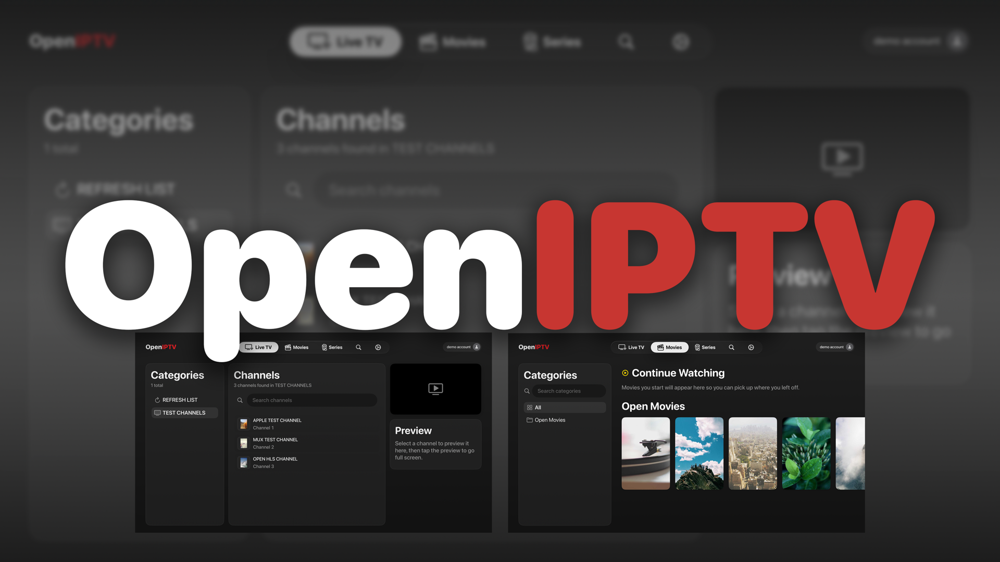

# OpenIPTV

<p align="center">
  
</p>

A free, open-source, native **tvOS 26** IPTV client for Apple TV. Bring your own
Xtream Codes account and watch your movies, TV series, and live channels with a
native SwiftUI interface.

> ⚠️ OpenIPTV **does not** ship any playlist, stream, or content, and has no
> affiliation with any provider. You supply your own Xtream Codes credentials.
> Use only with services you are legally entitled to access.

This project is a **bootstrap** — a clean, minimal foundation meant to be built on.
It ships the core of an IPTV client (auth, sync, browse, playback) with no paywall,
no subscriptions, and no tracking, so contributors can add features on top of a
solid base. See [CONTRIBUTING.md](CONTRIBUTING.md).

## Features

- **Native SwiftUI tvOS 26 UI** — focus-aware posters, native Liquid Glass materials
- **Movies, TV Series (seasons + episodes), and Live TV**
- **Live TV guide** — what's on now and next for each channel, with progress
- **Catch-up** — replay archived programmes on channels your provider records
- **AI guide clean-up (optional)** — bring your own OpenRouter key to tidy messy
  programme titles, pull out episode numbers and genres, and shorten descriptions
  (default model `google/gemini-3.8-flash`; only guide text is sent)
- **Favorite channels** — pinned at the top of the Live TV sidebar
- **Channel switching** — Previous/Next Channel from the full-screen player
- **Up Next** — the next episode starts automatically (with a countdown you can cancel)
- **Search** across movies, series and live channels
- **Continue Watching** — resume movies and episodes where you left off, also on the
  Apple TV **Top Shelf**
- **Multiple accounts** — add, switch and remove Xtream accounts in Settings
- **Subscription expiry** — refreshed on launch, with a warning in the last week
- **Parental PIN** — optional PIN to show adult content again once hidden
- **Local SwiftData cache** — the catalog is persisted on-device; first launch does
  the download, every subsequent launch renders instantly and only syncs deltas
- **Configurable sync** — automatic refresh (3/7/14 days or manual), with
  prune-on-refresh so titles removed by your provider disappear from the app
- **Resilient networking** — exponential-backoff retry, and HTTPS → HTTP fallback
  plus a custom resource loader for providers with self-signed certificates

## Requirements

- Xcode 17+
- tvOS 26.0 or later
- Swift 5 (SwiftUI, SwiftData)

## Getting started

1. Clone the repo
2. Open `OpenIPTV.xcodeproj` in Xcode
3. Select an Apple TV simulator or device
4. Build + run (`⌘R`)
5. On first launch, enter your Xtream server URL (e.g. `example.com`), username,
   and password

The one dependency ([Nuke](https://github.com/kean/Nuke), for image loading) is
resolved automatically by Swift Package Manager — no extra setup.

**Running on a real Apple TV:** pick your own team under *Signing & Capabilities* for
the `OpenIPTV` and `OpenIPTVTopShelf` targets. Both use the App Group
`group.io.OpenIPTV` for the Top Shelf row; if you change the bundle identifiers,
use your own group ID in both `.entitlements` files and in
`TopShelfShared.appGroup`. Simulator builds work without any signing setup (Top
Shelf just stays empty).

## Architecture

```
┌─────────────────────────────────────────────────────────────┐
│ SwiftUI Views (@Query-driven)                                │
│   MovieView / SerieView / LiveView / SearchView / Settings   │
└────────────────┬─────────────────────────────────────────────┘
                 │ @Observable @MainActor ViewModels
                 ▼
┌─────────────────────────────────────────────────────────────┐
│ PlaylistSyncService (@ModelActor)                            │
│   ├─ fetch categories + content via the repository           │
│   ├─ chunked upsert into SwiftData                           │
│   └─ prune-on-refresh (rows the provider dropped)            │
└────────────────┬─────────────────────────────────────────────┘
                 │
         ┌───────┴───────┐
         ▼               ▼
┌────────────────┐  ┌─────────────────────────────────────────┐
│ XtreamAPI      │  │ SwiftData on disk                        │
│  (retry +      │  │   Profile · CategoryEntity               │
│  https→http    │  │   MovieEntity · MovieDetailEntity        │
│  fallback)     │  │   SerieEntity · SeasonEntity             │
└────────────────┘  │   EpisodeEntity · LiveEntity             │
                    │   PlaybackProgress                       │
                    └─────────────────────────────────────────┘
```

**Key design points:**
- UI reads directly from SwiftData via `@Query` — no in-memory mirror
- Network calls go through the `IPTVRepository` protocol (injected via the
  environment); views never instantiate the API service directly
- Writes happen on the `@ModelActor`'s isolated context, never the main context
- Detail data (`MovieDetailEntity`, seasons, episodes) is lazy-fetched on first
  open and cached for 30 days
- The Xtream **password is stored in the Keychain**, never in SwiftData

## Project layout

```
OpenIPTV/
├─ Codables/          # API response shapes (Movie, Serie, Live, Category, Account)
├─ Models/            # SwiftData entities (MovieEntity, CategoryEntity, …)
├─ ViewModels/        # @Observable @MainActor view models
├─ Services/          # IPTVRepository + XtreamAPIService + PlaylistSyncService
├─ Support/           # PersistenceController, Keychain, ModelContext extensions
├─ Video Player/      # AVPlayerViewController bridge + self-signed stream loader
└─ *.swift            # Top-level views + shared design tokens (GlassStyle.swift)
```

## Contributing

Pull requests welcome — this repo exists to be extended. See
[CONTRIBUTING.md](CONTRIBUTING.md) for code style and the review flow.

## License

[MIT](LICENSE)
